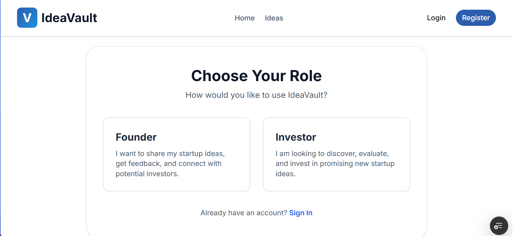
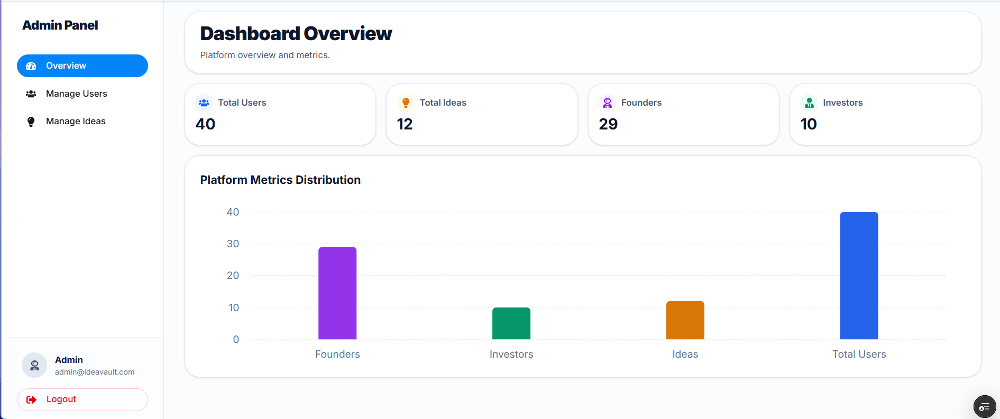
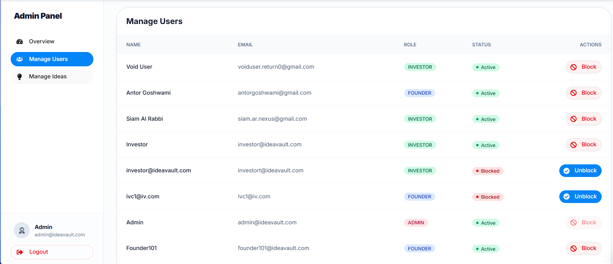
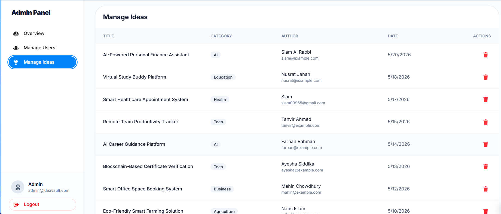

<div align="center">

# IdeaVault

**Collaborative Startup Idea & Community Innovation Sharing Platform**

A modern, full-stack web application designed for entrepreneurs, innovators, and changemakers to publish startup ideas, validate concepts through community discussions, and explore initiatives across tech, health, education, and sustainability. Built with Next.js 16 App Router, React 19, TypeScript, Tailwind CSS 4, HeroUI, Express 5, and MongoDB Atlas.

---

<!-- Badges Strip -->
[](https://nextjs.org/)
[](https://react.dev/)
[](https://www.typescriptlang.org/)
[](https://tailwindcss.com/)
[](https://heroui.com/)
[](https://expressjs.com/)
[](https://www.mongodb.com/)
[](LICENSE)

[](https://idea-vault-client-1.vercel.app)
[](https://github.com/Siam-AR/idea-vault-client)
[](https://github.com/Siam-AR/idea-vault-server)

</div>

---

## Table of Contents
1. [Overview & Core Value](#overview--core-value)
2. [Interface Previews](#interface-previews)
3. [Key Features](#key-features)
4. [Technology Stack](#technology-stack)
5. [System Architecture & Workflow](#system-architecture--workflow)
6. [Directory Structure](#directory-structure)
7. [API Route Specifications](#api-route-specifications)
8. [Getting Started & Local Installation](#getting-started--local-installation)
9. [Available Scripts](#available-scripts)
10. [Environment Variables](#environment-variables)
11. [Deployment](#deployment)
12. [Database Schema Models](#database-schema-models)
13. [Future Roadmap](#future-roadmap)
14. [Contributing Guidelines](#contributing-guidelines)
15. [License](#license)

---

## Overview & Core Value
**IdeaVault** (branded as **Community Spark**) bridges the gap between visionaries with raw concepts and an engaged community of collaborators, early adopters, and advisors. Instead of passive browsing, the platform prioritizes real-world concept validation, structured feedback loops, and transparent project tracking before capital or operational commitments are made.

### Primary Differentiators:
- **Collaborative Concept Validation**: Threaded discussions allow creators to receive constructive critiques, feasibility insights, and encouragement on problem statements and proposed solutions.
- **Granular Multi-Dimensional Discovery**: Full-text regex search by title, category filtering (Tech, Health, Education, Environment, AI, Community), and date range queries (`dateFrom`, `dateTo`).
- **Protected User Workspaces**: Protected private routes (`/add-project`, `/my-projects`, `/my-contributions`, `/profile`) guard sensitive interactions while preserving intended navigation upon login.
- **Modern Performance & Theme Engine**: Fast server-side rendering (SSR), TypeScript type safety, instant Dark/Light mode toggling with zero flash-of-unstyled-content (FOUC), and responsive layouts built with HeroUI and Tailwind CSS 4.

---

## Interface Previews

| Home | Ideas |
| :---: | :---: |
|  |  |

| Role | Overview |
| :---: | :---: |
|  |  |

| Manage Users | Manage Ideas |
| :---: | :---: |
|  |  |

---

## Key Features

### Role-Based Access Control (RBAC) — Who Can Do What
IdeaVault features 3 distinct user roles: **Founder**, **Investor**, and **Admin** (alongside public **Guest** browsing).

#### 1. Founder (Idea Creator)
- **Post Ideas**: Submit new startup ideas with details like problem, solution, category, and funding/budget needed.
- **Manage Own Ideas**: Edit details or delete their own posted ideas anytime from "My Projects".
- **Join Discussions**: Read feedback, answer questions, and post comments on any project.
- **Manage Own Comments**: Edit or delete comments they wrote.
- **Track Activity**: View all ideas they commented on in "My Contributions".

#### 2. Investor (Idea Explorer & Backer)
- **Discover Projects**: Search and filter ideas by category, budget, and date to find promising startups.
- **View Full Details**: Inspect full project plans, problem statements, solutions, and target markets.
- **Provide Feedback**: Comment on ideas to ask questions, offer advice, or express funding interest.
- **Manage Own Comments**: Edit or delete comments they wrote.
- **Track Engagements**: Keep track of all projects they engaged with from "My Contributions".

#### 3. Admin (Platform Manager)
- **Manage Content**: Review all ideas and comments across the entire platform.
- **Moderate & Remove**: Delete spam, inappropriate ideas, or abusive comments.
- **Oversee Users**: Ensure platform rules are followed and keep the community safe.

### Project Directory & Multi-Facet Filtering (`/projects`)
- **Responsive 3-Column Grid**: Uniform card layout showcasing title, short summary, category tags, author details, target audience, and comment tally.
- **Real-Time Title Search**: Case-insensitive substring matching using MongoDB `$regex`.
- **Category Filter**: Seamless filtering across Technology, Health, Education, Environment, AI, and Social Community sectors.
- **Date Range Filter**: Filter initiatives submitted between specific start (`$gte`) and end (`$lte`) timestamps.

### Concept Details & Discussion Engine (`/projects/[id]`)
- **Comprehensive Project Dossier**: Displays full problem statements, proposed solutions, required support, estimated budgets, and priority levels.
- **Interactive Comment System**: Authenticated users can post comments, edit their existing responses in place, and delete comments with automatic `commentCount` increments and decrements.
- **Author Attribution**: Profile avatars, user names, and exact timestamps for every discussion entry.

### Private Dashboards & Creator Controls
- **Add Idea / Project (`/add-project`)**: Dedicated submission form with validation for title, descriptions, category, estimated budget, target audience, problem statement, and proposed solution.
- **My Projects Dashboard (`/my-projects`)**: Dedicated view of all ideas created by the logged-in user, equipped with an in-place update modal and a delete confirmation dialog.
- **My Contributions Dashboard (`/my-contributions`)**: Activity feed tracking all projects where the user participated in discussions, with quick links back to the original threads.
- **Profile Management (`/profile`)**: Update profile display name and avatar URL with live synchronization in the navbar.

### Authentication & UI Resilience
- **Dual Authentication**: Secure email/password authentication alongside one-click Google OAuth via Google Identity and Better-Auth.
- **Password Enforcement**: Validates a minimum of 6 characters, requiring at least one uppercase and one lowercase letter.
- **Seamless Route Guards & Redirection**: Preserves intended destination routes when redirecting unauthenticated users to the login flow.
- **Non-Blocking Notifications**: Replaced default browser alerts with animated, custom toasts (`ToastProvider`).

---

## Technology Stack

### Frontend & Client Runtime
| Layer | Technology | Usage Description |
| :--- | :--- | :--- |
| **Framework** | Next.js 16.2.6 (App Router) | Server-rendered pages, layout nesting, and optimized client bundling |
| **Language** | TypeScript 6.0 | End-to-end type safety for interfaces, props, and API responses |
| **UI Library** | React 19.2.4 | Declarative components, hooks, and context state management |
| **Component Kit** | HeroUI 3.0.5 | Accessible dropdowns, modals, avatars, and form elements |
| **Styling** | Tailwind CSS 4 | Utility-first styling with native CSS variable color theming |
| **Carousel** | Swiper 12.1.4 | Touch-enabled hero banner with autoplay and fade effects |
| **Icons** | React Icons & Gravity UI | Tree-shakeable SVG icons across navigation and dashboards |
| **Authentication Client**| Better-Auth & JWT Client | Local token storage, session context, and protected route handlers |

### Backend & Infrastructure
| Layer | Technology | Usage Description |
| :--- | :--- | :--- |
| **Server Framework** | Express.js 5.2.1 | Lightweight REST API routing with CORS and error handling |
| **Language** | TypeScript / tsx | Strongly-typed API controllers and request/response interfaces |
| **Database** | MongoDB Atlas (Native Driver 7.2) | High-performance document database with native connection pooling |
| **Authentication Engine**| JWT (`jsonwebtoken`) & `bcryptjs` | Secure password hashing (10 salt rounds) and signed 7-day tokens |
| **OAuth Integration** | Google Auth Library | Token verification and OAuth profile onboarding |
| **Deployment / Edge** | Vercel | Scalable frontend hosting and serverless backend API execution |

---

## System Architecture & Workflow

```text
[ User Browser / Client ]
            │
            ▼
[ Next.js 16 App Router (Port 3000) ]
   ├── Context Providers (AuthContext, ThemeContext, ToastContext)
   ├── Public Pages (/, /projects, /about, /contact)
   └── Protected Views (/add-project, /my-projects, /my-contributions, /profile)
            │
            │ REST Calls (Bearer JWT in Authorization Header)
            ▼
[ Express.js 5 API Server (Port 5000) ]
   ├── verifyToken Middleware (JWT Verification)
   ├── Auth Controller (/auth/register, /auth/login, /auth/google, /auth/user)
   ├── Ideas Controller (/ideas, /ideas/featured, /ideas/:id, /user/ideas)
   └── Comments Controller (/comments, /comments/:ideaId, /comments/me)
            │
            │ MongoDB Driver 7.2 Connection Pool
            ▼
[ MongoDB Atlas Cluster: community-spark ]
   ├── users Collection (User accounts, hashed credentials, Google IDs)
   ├── community-ideas Collection (Projects, descriptions, tags, metrics)
   └── comments Collection (Idea discussions, timestamps, user references)
```

---

## Directory Structure
```text
idea-vault/
├── idea-vault-client/
│   ├── public/
│   │   ├── favicon.ico
│   │   └── screenshots/              # UI preview screenshots
│   │       ├── preview-home.png      # Home landing page
│   │       ├── preview-ideas.png     # Ideas directory & filters
│   │       ├── preview-role.png      # Role selection & access
│   │       ├── preview-admin-overview.png # Admin analytics overview
│   │       ├── preview-admin-manage-users.png # Admin user management
│   │       └── preview-admin-manage-ideas.png # Admin idea management & moderation
│   ├── src/
│   │   ├── app/
│   │   │   ├── layout.tsx            # Root HTML layout with providers and fonts
│   │   │   ├── page.tsx              # Home landing page with Swiper banner & metrics
│   │   │   ├── globals.css           # Tailwind 4 directives and theme variables
│   │   │   ├── not-found.tsx         # Custom 404 error page
│   │   │   ├── about/page.tsx        # About platform narrative
│   │   │   ├── contact/page.tsx      # Contact and inquiry view
│   │   │   ├── resources/page.tsx    # Founder and community guides
│   │   │   ├── login/page.tsx        # Credentials and Google sign-in
│   │   │   ├── register/page.tsx     # Account registration with password validator
│   │   │   ├── forgot-password/      # Password reset flow placeholder
│   │   │   ├── profile/page.tsx      # User profile update workspace
│   │   │   ├── projects/
│   │   │   │   ├── page.tsx          # Public directory with search & filters
│   │   │   │   └── [id]/page.tsx     # Full idea dossier & threaded comments
│   │   │   ├── add-project/page.tsx  # Idea creation form (Protected)
│   │   │   ├── my-projects/page.tsx  # User idea management & update modal (Protected)
│   │   │   ├── my-contributions/     # User comment activity feed (Protected)
│   │   │   └── api/auth/[...all]/    # Better-Auth server-side route handler
│   │   ├── components/
│   │   │   ├── Navbar.tsx            # Sticky navigation with theme toggle & user dropdown
│   │   │   ├── Footer.tsx            # Platform footer with category & social links
│   │   │   ├── TrendingIdeas.tsx     # Featured ideas card carousel/grid
│   │   │   ├── IdeaComments.tsx      # Comment thread with add, edit, delete logic
│   │   │   ├── InfoHighlights.tsx    # Platform core pillars
│   │   │   ├── ParticipationSteps.tsx# Workflow step cards
│   │   │   ├── CommunityResources.tsx# Guide cards and quick links
│   │   │   ├── RouteTitleManager.tsx # Dynamic document title manager
│   │   │   └── Loader.tsx            # Reusable animated loading spinner
│   │   ├── lib/
│   │   │   ├── api.ts                # Centralized typed fetch client (apiCall)
│   │   │   ├── auth.ts               # Better-Auth configuration
│   │   │   ├── auth-client.ts        # Browser auth client instance
│   │   │   ├── auth-context.tsx      # Global auth state & user session provider
│   │   │   ├── auth-redirect.ts      # Redirect utility preserving return path
│   │   │   ├── theme-context.tsx     # Light/Dark mode state with localStorage sync
│   │   │   └── toast-context.tsx     # Custom toast notifications engine
│   │   └── types/
│   │       └── index.ts              # TypeScript interfaces (Idea, User, Comment)
│   ├── package.json
│   ├── tsconfig.json
│   └── next.config.mjs
└── idea-vault-server/
    ├── server.ts                     # Express app, JWT auth, MongoDB routes
    ├── package.json                  # Server scripts & dependencies
    ├── tsconfig.json                 # TypeScript compiler configuration
    └── vercel.json                   # Serverless deployment configuration
```

---

## API Route Specifications

### 1. Authentication Endpoints
- `POST /auth/register` — Register a new account with email, name, image, and hashed password. Returns JWT token and user info.
- `POST /auth/login` — Authenticate user credentials and return a signed 7-day JWT token.
- `POST /auth/google` — Sign in or automatically register via Google OAuth.
- `GET /auth/user` *(Protected)* — Fetch current authenticated user's profile data.
- `PATCH /auth/user` *(Protected)* — Update user profile display name or avatar image URL.

### 2. Idea & Project Management Endpoints
- `GET /ideas/featured` — Fetch up to 6 featured ideas for the homepage showcase.
- `GET /ideas` — Query ideas with optional filters:
  - `search` (Title substring matching via `$regex`)
  - `category` (Exact category filter)
  - `dateFrom` & `dateTo` (ISO date bounds via `$gte` and `$lte`)
- `GET /ideas/:id` — Retrieve complete idea record by its MongoDB `ObjectId`.
- `POST /ideas` *(Protected)* — Submit a new idea/project (Title, descriptions, category, budget, target audience, problem statement, proposed solution).
- `PATCH /ideas/:id` *(Protected)* — Update an existing idea (enforces author ownership).
- `DELETE /ideas/:id` *(Protected)* — Remove an idea from the database (enforces author ownership).
- `GET /user/ideas` *(Protected)* — Retrieve all ideas created by the logged-in user.

### 3. Discussion & Comment Endpoints
- `GET /comments/:ideaId` — Fetch all comments for a specific idea with author profile details.
- `POST /comments` *(Protected)* — Post a new comment on an idea (automatically increments `commentCount`).
- `GET /comments/me` *(Protected)* — Fetch all comments authored by the current user across all projects.
- `PATCH /comments/:commentId` *(Protected)* — Update comment text (enforces author ownership).
- `DELETE /comments/:commentId` *(Protected)* — Remove a comment (enforces author ownership).

---

## Getting Started & Local Installation

### Prerequisites
- **Node.js**: v18.18.0 or higher (Node 20+ recommended)
- **Package Manager**: npm, pnpm, or yarn
- **Database**: Active MongoDB Atlas cluster URI or local MongoDB instance

### Step-by-Step Setup

1. **Clone the repositories:**
   ```bash
   # Clone client
   git clone https://github.com/Siam-AR/idea-vault-client.git
   # Clone server
   git clone https://github.com/Siam-AR/idea-vault-server.git
   ```

2. **Configure & Start the Server:**
   ```bash
   cd idea-vault-server
   npm install
   ```
   Create a `.env` file in `idea-vault-server`:
   ```env
   PORT=5000
   MONGODB_URI=your_mongodb_connection_string
   MONGODB_DB_NAME=community-spark
   JWT_SECRET=your_super_secret_jwt_key
   CLIENT_URL=http://localhost:3000
   ```
   Start the development server:
   ```bash
   npm run dev
   ```

3. **Configure & Start the Client:**
   ```bash
   cd ../idea-vault-client
   npm install
   ```
   Create a `.env.local` file in `idea-vault-client`:
   ```env
   NEXT_PUBLIC_API_URL=http://localhost:5000
   NEXT_PUBLIC_SERVER_URL=http://localhost:3000
   BETTER_AUTH_SECRET=your_better_auth_secret
   BETTER_AUTH_URL=http://localhost:3000
   MONGODB_URI=your_mongodb_connection_string
   GOOGLE_CLIENT_ID=your_google_client_id.apps.googleusercontent.com
   GOOGLE_SECRET=your_google_client_secret
   NEXT_PUBLIC_GOOGLE_CLIENT_ID=your_google_client_id.apps.googleusercontent.com
   ```
   Start the client development server:
   ```bash
   npm run dev
   ```

4. **Access the application:**
   Open [http://localhost:3000](http://localhost:3000) in your web browser.

---

## Available Scripts

### Client Application (`idea-vault-client`)
| Command | Description |
| :--- | :--- |
| `npm run dev` | Runs the Next.js development server on `http://localhost:3000`. |
| `npm run build` | Compiles and optimizes the application for production. |
| `npm run start` | Boots the compiled Next.js production server. |
| `npm run lint` | Runs ESLint to check code quality and syntax standards. |

### Server Application (`idea-vault-server`)
| Command | Description |
| :--- | :--- |
| `npm run dev` | Executes `server.ts` directly with `tsx` runtime. |
| `npm run dev:nodemon`| Watches file changes and hot-reloads with `nodemon` and `tsx`. |
| `npm run build` | Compiles TypeScript into JavaScript inside the `dist/` directory. |
| `npm run start` | Starts the compiled production server (`node dist/server.js`). |

---

## Environment Variables

### Client Environment Variables (`.env.local`)
```env
# Backend API Base URL
NEXT_PUBLIC_API_URL=http://localhost:5000
NEXT_PUBLIC_SERVER_URL=http://localhost:3000

# Better-Auth Configuration
BETTER_AUTH_SECRET=your_better_auth_secret_hash
BETTER_AUTH_URL=http://localhost:3000

# MongoDB URI (Used by Better-Auth Mongo Adapter)
MONGODB_URI=mongodb+srv://<username>:<password>@cluster0.mongodb.net/?appName=Cluster0

# Google OAuth Credentials
GOOGLE_CLIENT_ID=your-google-client-id.apps.googleusercontent.com
GOOGLE_SECRET=your-google-client-secret
NEXT_PUBLIC_GOOGLE_CLIENT_ID=your-google-client-id.apps.googleusercontent.com
```

### Server Environment Variables (`.env`)
```env
PORT=5000
MONGODB_URI=mongodb+srv://<username>:<password>@cluster0.mongodb.net/?appName=Cluster0
MONGODB_DB_NAME=community-spark
JWT_SECRET=your_secure_random_jwt_secret_key
CLIENT_URL=http://localhost:3000
```

---

## Deployment

### Frontend (Client) on Vercel
1. Import `idea-vault-client` repository into Vercel.
2. Select **Next.js** framework preset.
3. Configure the environment variables (`NEXT_PUBLIC_API_URL`, `BETTER_AUTH_SECRET`, `GOOGLE_CLIENT_ID`, etc.).
4. Click **Deploy**. Vercel will execute `npm run build` and launch the application on the edge network.

### Backend (Server) on Vercel
1. The server repository includes a `vercel.json` file configuring the `@vercel/node` runtime builder for `server.ts`.
2. Ensure environment variables (`MONGODB_URI`, `JWT_SECRET`, `CLIENT_URL`) are provided in the Vercel project settings.
3. Set your MongoDB Atlas network access list to allow connections from any IP (`0.0.0.0/0`) or peer your serverless endpoints.

---

## Database Schema Models

```text
User Document (users collection)
├── _id: ObjectId
├── name: String
├── email: String (Unique)
├── role: "founder" | "investor" | "admin"
├── password: String (Bcrypt Hash, optional for Google users)
├── image: String (Avatar URL)
├── googleId: String (Optional)
├── authMethod: "credentials" | "google"
├── createdAt: Date
└── updatedAt: Date

Idea Document (community-ideas collection)
├── _id: ObjectId
├── title: String
├── shortDescription: String
├── detailedDescription / fullDescription: String
├── category: "Tech" | "Health" | "AI" | "Education" | "Environment" | "Community"
├── tags: Array<String>
├── imageURL: String
├── location / targetAudience: String
├── supportNeeded / problemStatement: String
├── priority / proposedSolution: String
├── estimatedBudget: String
├── userId: ObjectId (Ref: users)
├── userName: String
├── userEmail: String
├── likes: Number (Default: 0)
├── commentCount: Number (Default: 0)
├── createdAt: Date
└── updatedAt: Date

Comment Document (comments collection)
├── _id: ObjectId
├── ideaId: ObjectId (Ref: community-ideas)
├── userId: ObjectId (Ref: users)
├── text: String
├── createdAt: Date
└── updatedAt: Date
```

---

## Future Roadmap

IdeaVault continues to expand its platform capabilities. The following milestones are planned for future iterations:

- **Upvote & Bookmark System**: Allow users to upvote promising ideas and save them to a personal bookmark collection.
- **Rich Markdown Editor**: Support rich formatting, code blocks, and architecture diagrams in project detailed descriptions.
- **Direct Collaborator Outreach**: Connect founders with potential co-founders, developers, and advisors via direct messaging.
- **Live Pitch & Feedback Rounds**: Scheduled interactive feedback sessions for startup teams preparing for demo days.

---

## Contributing Guidelines

Contributions keep open-source platforms vibrant and useful. To contribute:

1. Fork the Project Repository.
2. Create your Feature Branch:
   ```bash
   git checkout -b feature/AmazingFeature
   ```
3. Commit your Changes:
   ```bash
   git commit -m "feat: add AmazingFeature support"
   ```
4. Push to the Branch:
   ```bash
   git push origin feature/AmazingFeature
   ```
5. Open a Pull Request detailing your changes and test coverage.

---

## License

Distributed under the MIT License. See `LICENSE` for further details.
